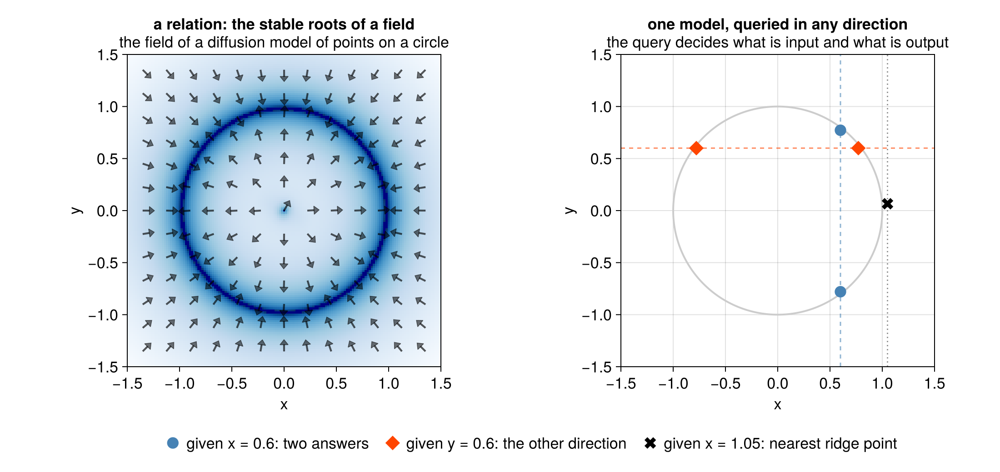

# Lenticulum.jl

[](https://github.com/MathStruct/Lenticulum.jl/actions/workflows/CI.yml?query=branch%3Amaster)
[](https://mathstruct.org/Lenticulum.jl/api/dev/)
[](https://doi.org/10.5281/zenodo.23314723)

**Learn relations, not functions.** A neural network learns $f_\theta : X \to Y$ and can only be
run one way. Lenticulum learns a *relation* $R_\theta$ on a joint space $Z$ and decides at query
time which coordinates are inputs and which are outputs. The same trained model then answers
"given $x$, what is $y$?", "given $y$, what is $x$?", and "fill in whatever is missing".

> **Status: research prototype.** Julia, not registered, one author. What is exact is tested
> against closed forms; what is approximate says so.

## The idea in one picture

Train once on points of a circle. Then ask:

| query | inputs | outputs | answer |
|---|---|---|---|
| $x = 0.6$, what is $y$? | $x$ | $y$ | $y \approx \pm 0.8$ — **two answers**; the starting guess picks one |
| $y = 0.6$, what is $x$? | $y$ | $x$ | $x \approx \pm 0.8$ — same model, other direction |
| $x = 1.05$, just off the circle? | $x$ | $y$ | still an answer ($y \approx 0.07$): a point on the smoothed relation's ridge, not an error |



*Left:* the field of a diffusion model of points on a circle; it vanishes (dark) on the circle,
and its stable roots are the relation. *Right:* the three queries of the table, answered by that
one model. This is the closed-form model of the [example below](#a-minimal-example);
[tutorial 2](https://mathstruct.org/Lenticulum.jl/api/dev/tutorials/02_train/) trains a small network
and answers the same queries. ([`docs/readme_figure.jl`](docs/readme_figure.jl) draws it.)

A function cannot do any of these three things. A relation does all of them.

## The analogy behind it: polynomials and varieties

The clean case that motivates every design choice. An explicit learner fits a polynomial
$y = f_\theta(x)$; an implicit learner fits the zero set of a polynomial residual,
$\{z : r_\theta(z) = 0\}$, an algebraic variety:

| aspect | explicit | implicit |
|---|---|---|
| **approximator** | functions $f_\theta : X \to Y$ (polynomials) | relations $R_\theta \subseteq Z$ (algebraic varieties) |
| **inference** | forward evaluation | root finding |
| **backpropagation** | reverse-mode automatic differentiation | the implicit function theorem |
| **universal approximation** | continuous functions on compacta (Weierstraß) | compact smooth manifolds (Nash–Tognoli) |
| **well-posedness** | always single-valued | may be multi-valued, or have no solution (then: the closest point) |
| **loss** | $\lVert f_\theta(x) - y\rVert^2$ | $\lVert r_\theta(z)\rVert^2$ |
| **symmetry** | fixed input → output direction | no distinguished input or output |
| **cost of inference** | cheap | expensive (Newton's method, …) |
| **wiring** | directed acyclic graph | arbitrary graph |

## How it works

1. **A relation is the zero set of a learned residual**, $R_\theta = \{z \in Z : r_\theta(z) = 0\}$.
2. **A query chooses a polarity**: it splits the coordinates of $Z$ into inputs $X$, outputs $Y$
   and latents $U$, with a precision per coordinate (∞ = hard input, 0 = free output, in between =
   soft evidence).
3. **Inference is root-finding** on the residual with the inputs clamped, the way a deep
   equilibrium model is evaluated.
4. **Backpropagation is the implicit function theorem**: one adjoint linear solve gives the
   gradients for the parameters, the inputs and the precisions. Nothing is unrolled.

The library is built around three uses:

| path | what you get | packages |
|---|---|---|
| **A. Gaussian factor graphs** | exact smoothing and state estimation on linear-Gaussian graphs, nonlinear measurements by linearisation, the free energy and its gradient (as in [GTSAM](https://gtsam.org/), the project's inspiration, with factors that can be learned) | `LenticulumCore`, `Mycelium`, `Lenticulum` |
| **B. Relation learners** | a diffusion model queried in any direction by root finding, with an adjoint backward pass, Laplace beliefs and conditional sampling | `VariationalDiffusion` |
| **C. Structure and regimes** | switching and regime factors, hierarchical models, expectation maximisation, search over structures | `Lenticulum`, `Mycelium`, `MyceliumLearning` |

Three further packages are off the three paths and **not yet reviewed** as the core was: deep
equilibrium models and neural ODEs (`ImplicitLayers`), exact discrete toric models
(`AlgebraicFactors`) and implicit generative models (`Adversarial`). Their suites pass and run
weekly rather than on every push ([the refactor note](vault/Project/Refactor%202026-11.md)).

## A minimal example

```julia
using VariationalDiffusion, LuxCore, Random
sched = VPSDE()
θ = range(0, 2π; length = 49)[1:48]
circle = NoisePredictor(GaussianMixtureEps(sched, vcat(cos.(θ)', sin.(θ)'); s = 0.05), sched)
ps, st = LuxCore.setup(Xoshiro(0), circle)            # a diffusion model of the unit circle
m = ImplicitDiffusion(circle, field_nodes(Xoshiro(1), 2; samples = 8))

up, _ = implicit_infer(m, [0.6,  0.5], [Inf, 0.0], ps, st)   # x clamped (∞), y free (0)
dn, _ = implicit_infer(m, [0.6, -0.5], [Inf, 0.0], ps, st)   # same query, other start
up.z[2], dn.z[2]                                              # ≈ (0.78, -0.78): two branches
```

The closed-form circle model is used so the example needs no training. `implicit_pullback`
differentiates the answer, and training a relation through its own inference (a parabola
learned from a circle) is worked through in the vault.

## Where to go next

| you are | start with |
|---|---|
| **who learns by running code** | the [tutorials](https://mathstruct.org/Lenticulum.jl/api/dev/tutorials/01_circle/) (also as Jupyter notebooks): the circle, a trained MLP, a robot arm, ProxDM, an energy-parametrised diffusion model, GTSAM-style localisation, a kernel baseline the network has to beat, intersections of separately trained models, and switching mixtures |
| **from machine learning** | [Implicit Diffusion Learners](https://mathstruct.org/Lenticulum.jl/Relation-Learners/Implicit-Diffusion-Learners) → [Backpropagation through Implicit Inference](https://mathstruct.org/Lenticulum.jl/Relation-Learners/Backpropagation-through-Implicit-Inference) |
| **from statistics / robotics** | the [localisation tutorial](https://mathstruct.org/Lenticulum.jl/api/dev/tutorials/08_localization/) → [The Linear Gaussian Chain](https://mathstruct.org/Lenticulum.jl/Gaussian-Graphs/The-Linear-Gaussian-Chain) → [Bethe Free Energy](https://mathstruct.org/Lenticulum.jl/Gaussian-Graphs/Bethe-Free-Energy) |
| **from category theory** | [Factors are Parameterized Statistical Games](https://mathstruct.org/Lenticulum.jl/Foundations/Factors-are-Parameterized-Statistical-Games), with the background in the [CT-ML wiki](https://mathstruct.org/CategoryTheory-ML-Wiki/) (Track E) |
| **looking for an API** | the [API documentation](https://mathstruct.org/Lenticulum.jl/api/dev/) |

The **theory vault** ([website](https://mathstruct.org/Lenticulum.jl/); also this
repository opened in [Obsidian](https://obsidian.md), starting from `vault/Start Here.md`) holds
the derivations, the papers, the design decisions and the list of what does not work yet.

**References.** Every work cited in the tutorials, the notes and the vault (about 260 papers, books
and software packages) is in one BibTeX file, [`docs/src/refs.bib`](docs/src/refs.bib). It is rendered
as the documentation's [References](https://mathstruct.org/Lenticulum.jl/api/dev/references/)
page and the vault's [Bibliography](https://mathstruct.org/Lenticulum.jl/Bibliography),
and it is the reference list of [`CITATION.cff`](CITATION.cff). To cite Lenticulum itself, use
the Zenodo DOI [10.5281/zenodo.23314723](https://doi.org/10.5281/zenodo.23314723).

**A graphical editor.** [Moonkale](https://github.com/MathStruct/Moonkale), a sister project
written in Rust (desktop, web and Android), is a graph-native editor for code and notes. One of
its goals is to edit factor graphs for Lenticulum, Lux.jl, ModelingToolkit.jl and RxInfer.jl as
diagrams that stay diagrams instead of becoming code
([the plan](https://mathstruct.github.io/Moonkale/architecture/Julia-and-Lenticulum)). It is a
prototype; the vault can already be browsed in it as a graph.

## What is in the repository

Five packages under `lib/`. All depend on **LuxCore** only (not Lux, Zygote or Optimisers), so
any Lux model wraps as a factor without pulling them in. Automatic differentiation and Reactant
compilation come in through package extensions, for whichever backend you load.

| package | gives you |
|---|---|
| `LenticulumCore` | what a **factor** is: channels, polarities, energies; the **belief** types (Gaussian, categorical, mixture, Dirac, sample), convertible to RxInfer's |
| `Mycelium` | **inference**: graphs, messages, schedules, plates, cluster nodes, the free energy |
| `MyceliumLearning` | **learning** on a graph: free-energy gradients, expectation maximisation, the optimiser step |
| `Lenticulum` | the **factors**: linear-Gaussian, nonlinear, linear constraints, switching and regime factors, likelihoods; their closed-form M-steps |
| `VariationalDiffusion` | **diffusion models** as relations: VP-SDE, implicit inference with an adjoint backward pass, Laplace and mixture answers, conditional sampling, RED-Diff, ProxDM |

`lib/` also holds `ImplicitLayers`, `Adversarial` and `AlgebraicFactors` (not yet reviewed;
tested weekly); `vault/` the theory notes; `docs/` the Documenter
pages and tutorials; `bench/` the benchmarks.

## How it relates to what you know

- **Lux.jl.** Lenticulum builds on LuxCore and can use any Lux model. A Lux layer is a fixed
  forward/backward pair. A Lenticulum factor becomes one only after a query chooses its inputs,
  and its backward pass can be a posterior rather than a gradient.
- **Deep equilibrium models / implicit layers.** Same inference (root-finding) and the same
  backward pass (the implicit function theorem). The difference is that the direction is not
  fixed, and a factor carries an energy with a probabilistic reading.
- **Diffusion-based inverse problems** (RED-Diff, DPS). These are inference methods for one
  direction of the relation. Lenticulum makes the deterministic version differentiable, so the
  relation can be *trained* through its own inference.
- **GTSAM / factor-graph SLAM.** The same graphs and message passing, generalised to learned,
  non-Gaussian factors. Today the exact results are on the linear-Gaussian fragment.
- **Category theory.** A factor is a parameterized statistical game in the sense of AutoBayes,
  and a lens once a polarity is chosen; the CT-ML wiki has the background. You do not need any
  of it to use the code.

## Using it

Not registered. From a clone:

```julia
using Pkg
Pkg.develop(path = "/path/to/Lenticulum.jl/lib/Lenticulum.jl")             # paths A and C
Pkg.develop(path = "/path/to/Lenticulum.jl/lib/VariationalDiffusion.jl")   # path B
```

Tests, per package:

```sh
julia --project=lib/Lenticulum.jl              -e 'using Pkg; Pkg.test()'
julia --project=lib/VariationalDiffusion.jl    -e 'using Pkg; Pkg.test()'
# ... likewise for lib/LenticulumCore.jl, lib/Mycelium.jl, lib/MyceliumLearning.jl
```

The JLArrays device tests of Mycelium run only with `LENTICULUM_DEVICE_TESTS=true` set.

Documentation, API and vault together:

```sh
julia --project=docs -e 'using Pkg; Pkg.instantiate()'
julia --project=docs docs/make.jl          # API docs + the vault, into docs/build/
docs/site/build.sh --serve                 # just the vault, live-previewed (Node ≥ 22)
```

## Status and limits

A prototype. What is exact is tested against closed forms: random linear-Gaussian trees
against the dense joint solve, switching chains against enumeration, the diffusion field against
a Gaussian mixture's score. Known limits:

- a mixture message into a Gaussian or constraint factor is collapsed to its moments unless the
  switch and what it reaches are in one cluster node; a tree is exact only in the second case;
- the cost of inference grows quadratically with the number of separately parametrised factors
  (thousands of them are slow; plates with tied parameters are not affected);
- the implicit learner recovers the ridge of a smoothed density, not the data's support, and
  every query returns a root, on the relation or not (the calibration benchmark in
  `lib/VariationalDiffusion.jl/examples/calibration.md`);
- point inference returns one branch of a multivalued relation; `implicit_roots` and
  `implicit_mixture` collect several, and `implicit_sample` samples a query by replacement.

Learned networks are small by design (a factor's joint space has a handful of coordinates); one
is trained, queried and differentiated through its own inference in
`lib/VariationalDiffusion.jl/examples/circle_mlp.jl`, with the AD backend chosen per model
(Zygote, Enzyme, ForwardDiff, Mooncake, or Reactant). The vault's *Related Julia Projects* says
what to use instead when you need only one of the things this combines.

## Contributing

Contributions of every kind are welcome: code, notes, derivations, reviews, and discussion on
the vault's pages. How credit and authorship are handled (community recognition, Zenodo
contributors and creators, CRediT roles) is in
[CONTRIBUTING.md](https://github.com/MathStruct/Lenticulum.jl/blob/master/CONTRIBUTING.md).
