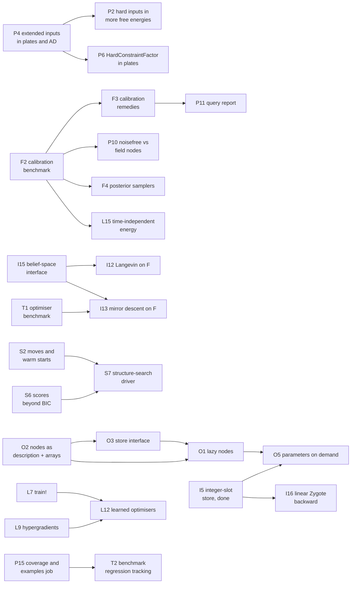

#overview

> The features Lenticulum.jl should get, in one list: what each is for, where it was asked for,
> what measurement motivates it, and how far it is. A feature is added here when a
> specification, a problem, a review or a measurement asks for it, and moved to "done" with the
> commit that implemented it. Priorities are proposals until Daniel sets them.

> Sources: original to this repository; the open lists of [[Specifications]] and [[Problem Log]], [[LP-023 Findings of the external reviews of 2026-11-04]].

Status: *planned* (specified or asked for, not started), *proposed* (an idea with a reason, no
specification), *partial*, *done*. Priority: **high** (it limits something measured now),
**medium**, **low**.

**Ids and dependencies.** Every open row has an id: P (the three paths), I (inference), O
(out-of-core), S (structure), L (learning), U (utility factors), F (families), T (tooling). The
column *needs* names the rows that must be done first, because the row builds on them; a row that
only goes better after another says so in its text, not there. Ids are stable: a row that is done
moves to "Done" with its id, and a new row takes the next free number of its section. A row with
`—` in *needs* can start now.

## What depends on what

The open rows that need another open row (every row not drawn here needs nothing open):

F2 is *partial*; its present problems (circle, lemniscate, rings) suffice for P10, F3, F4 and L15.

**Proposed order (2026-11-11, until Daniel sets one):** ~~I5~~ (done 2026-11-12; the gap against
RxInfer, [[Benchmark against RxInfer]], not measured again since); ~~P1~~ (done 2026-11-12; it found a ForwardDiff
regression and a silent no-op in damping); ~~P17 and P18~~ (done 2026-11-12) (P19 done 2026-11-12 with I18; I18 done 2026-11-12); then P11 with F3 for
path B, and I6 for path C.

## First, on the three paths (2026-11-10)

After the refactor ([[Refactor 2026-11]]) work on the paths comes before everything below. The
rows here are the ones that review asked for; rows further down that serve the same end are
named. The structure-search driver (path C) is S7.

| id | feature | path | status | needs | source | why |
|---|---|---|---|---|---|---|
| P2 | Hard inputs in the free energies of `SwitchingConstraintFactor`, the plate paths and the frozen beliefs of the gradient | A, C | proposed | P4 | [[lib/Lenticulum.jl/src/gaussian\|gaussian]] "Free energy with hard inputs" | refused or untested there |
| P3 | A `TrivialBelief()` input (no message) to `GaussianFactor` takes the exact flat path, as an everywhere-flat `ExtendedGaussian` does | A | proposed | — | [[lib/Lenticulum.jl/src/gaussian\|gaussian]] "Extended Gaussian inputs" (2026-11-11) | with $n_{\text{in}} < n_{\text{out}}$ the shortcut returns no message where the exact one fixes $y$ off $\operatorname{range}(A)$; changes the first sweep of every schedule, so measure it on the existing tests first |
| P4 | Extended-Gaussian inputs in plates and in the AD message paths (`_gradient_message`) | A, C | proposed | — | [[lib/Lenticulum.jl/src/gaussian\|gaussian]] "Extended Gaussian inputs" | untested there |
| P5 | `HardConstraintFactor` with a singular nonzero noise in the free energy (hard along its null space, soft along its range); learnable (its term needs an SVD, which ForwardDiff lacks) | A, C | proposed | — | [[hard_constraint]] "Free energy" (2026-11-11) | refused today |
| P6 | `HardConstraintFactor` in plates (a `factor_messages` block method) and in `MeanField()` nodes | A, C | proposed | P4 | [[hard_constraint]] "What it does not do" | a plate of hard constraints runs per replica; mean-field nodes refuse it |
| P8 | Element type in, element type out: the graph free energy in the element type of its messages, with a test | A | partial: LenticulumCore (2026-11-10) | — | LP-024 | `Float32` graphs are promoted to `Float64` in the total |
| P9 | A relative convergence criterion for Gaussian messages | A | proposed | — | LP-024 | the bound on natural parameters is absolute |
| P10 | `noisefree_nodes` against `field_nodes` on the calibration benchmark; a default for the nodes | B | proposed | F2 | [[Implicit Diffusion Learners]] §5 (2026-11-10) | nodes with noise have twice the smoothing bias at a level |
| P11 | A query report: converged, stable, the roots from other starts, the conditioning of the answer, on or off the relation | B | proposed | F3 | review of 2026-11-09; "Calibration remedies" below | every query returns a root today, and nothing says how far it can be trusted |
| P12 | `density_lambda` as the default for non-point messages | B | partial: a warning (2026-11-10) | — | LP-024 | uncalibrated covariances reach the graph silently |
| P13 | The exactness condition checked at run time: `propagate!` does not report "exact" for a tree on which a mixture is collapsed | A, C | proposed | — | [[Bethe Free Energy]] | the report is wrong for such graphs |
| P14 | A shared solver layer (root finding, the implicit-function adjoint, one tolerance rule, one report), shared by `VariationalDiffusion` and `ImplicitLayers` | B | proposed | — | [[Refactor 2026-11]] | three implementations with three conventions; `ImplicitLayers`' tolerances are absolute and written for `Float64`. Its first fix, now that it is back in `lib/` |
| P15 | A coverage report; a job that runs the examples and benchmarks at small size | all | proposed | — | review of 2026-11-09 | which branches no test reaches is unknown; examples and benchmarks are run by nothing (`Aqua.jl` in every suite: done 2026-11-10) |
| P16 | Owned scalarisations: one graded energy, a scalarisation chosen per parameter key (each block descends its own), for games such as a GAN; with a stability check of the joint Jacobian | — | proposed | — | [[GANs as Two Factors]] §4 (2026-11-10) | every learnable node descends the one scalar $F$, so no game is expressible; a per-factor sign is the zero-sum special case |
| P20 | Zygote through `scalar_free_energy` on plates with block rows: `_row_scalar` calls `sum(...; init = 0.0)`, for which ChainRules has no rrule (`MethodError`) | A, C | proposed | — | Mistral's review of 2026-11-11 (`lib/Mycelium.jl/src/passing.md`, "The state tree") | a defect, not a feature: the gradient of a plated free energy by Zygote fails; found by running, the same before and after P7 |
| P21 | ForwardDiff through a relation factor's flat-input path: a flagged `GaussianBelief` of dual numbers entering `_flat_message` or `_linear_message` with flat inputs | A, C | proposed | — | [[lib/Lenticulum.jl/src/gaussian\|gaussian]] "Where the two forms meet" | P1 (2026-11-12): throws a `MethodError` (an eigendecomposition and an SVD of duals), `@test_broken` in `lib/Lenticulum.jl/test/forms_crossing.jl`. With only η dual (a derivative by `b`, `c` or an observation) the flat directions do not move, so a derivative exists: split and project on values, carry the duals through η. Also `NonlinearFactor`'s backward message at a dual expansion point: `_jacobian` writes into a `Float64` matrix (`MethodError: Float64(::Dual)`, `@test_broken`, LP-028 F3) |

## Inference and graph execution

| id | feature | status | needs | priority | source | why |
|---|---|---|---|---|---|---|
| I1 | Compilation per structure in the free-energy and EM paths | partial: message loop (2026-11-04), free energy, cluster code and EM outside AD (2026-11-05) | — | medium | `passing.md` "Compilation per structure" | a new structure still compiles 1.14 s for F, `em_step` and a fit (0.31 s warm); the AD paths and ForwardDiff's chunks remain |
| I2 | Typed execution plans: factors grouped by type and rule, kernels compiled once per signature | proposed | — | medium | both reviews (LP-023) | the graph stores factors abstractly; plates are the first step |
| I3 | A spanning-tree schedule for loopy graphs (`spanning_tree_schedule(g)`: the messages off a spanning tree, then the tree's inward and outward sweeps, in place; the updates of tree-based reparameterisation) | partial: done in Mycelium (2026-11-09; `schedules.md`); the choice of tree and alternating trees remain | — | high | [[Composing Optimisers]] §4.2 (2026-11-09) | measured on the divider (`bench/bp_schedules.jl`): 0.17–0.18 of flooding's message evaluations to an error of 1e-10, in all four settings, with no knowledge of the loop; with `infer!` 82 sweeps against 463 (`test/runtests.jl`). On Gaussian grids up to 20 × 20 (`bench/bp_grid.jl`, 2026-11-09): 0.17–0.29 of flooding's sweeps; its Jacobian has at most two nonzero eigenvalues per independent loop ([[Composing Optimisers]] §4.4). Untested: graphs where BP oscillates, non-Gaussian graphs |
| I4 | A dependency-aware priority queue for `ResidualSchedule` | proposed | — | medium | ChatGPT review (LP-023) | each sweep probes every task, $O(T^2)$ evaluations: 2.1 times flooding's on the divider. A queue prototype in `bench/bp_schedules.jl` needs 0.24–0.31 of flooding's, behind the spanning-tree order ([[Composing Optimisers]] §4.2) |
| I6 | Batched cluster nodes with per-outcome forms over a plate | planned | — | medium | [[L-SPEC-009 Cluster Nodes]] open; [[Benchmark against RxInfer]] (2026-11-11) | `RegimeFactor` plates go replica by replica: `fit_em` on a mixture of two regressions takes 1.2 s at $N = 300$ and 32 s at 3 000, against 0.6 and 6.5 ms for closed-form EM and 0.13 and 3.2 s for RxInfer's VMP |
| I7 | Mixture-reduction and EP nodes batched in plates | planned | — | low | [[L-SPEC-008 Expectation Propagation and Mixture Reduction]] open | edge by edge today |
| I8 | Clusters with loops; several mean-field variables in one cluster | planned | — | low | [[L-SPEC-007 Hybrid Schedules]] open | |
| I9 | Nested plates; stateful tied factors | planned | — | low | [[L-SPEC-006 Plates]] open | |
| I10 | Incremental inference (reuse factorisations and beliefs after a local change, iSAM2-like) | proposed | — | low | ChatGPT review; LenticulumLM's [Incremental Next-Token Prediction](https://mathstruct.org/LenticulumLM/Design/Incremental-Next-Token-Prediction) (an idea, 2026-11-05) | online learning, SLAM-like use, and next-token prediction as appending factors; `transfer` gives warm starts today, not reuse of factorisations |
| I11 | A lazy product-of-potentials belief with explicit approximation policies | proposed | — | low | ChatGPT review | learned potentials without silent Gaussian projection |
| I12 | Underdamped Langevin dynamics on the Bethe free energy: beliefs $b$ (with a mass, e.g. Fisher) get a momentum $p$, with $\dot b = p$, $\dot p = -\nabla F(b) - \gamma p + \sqrt{2\gamma T}\,\xi$. At $T = 0$ the friction $\gamma$ brakes $H = F + \tfrac12\lVert p\rVert^2$ at every step ($\dot H = -\gamma\lVert p\rVert^2$), a Lyapunov function that a BP sweep lacks; with $T$ annealed to 0 it could also hop between fixed points. An idea, untested. To settle: must it descend $\nabla F$ directly (a BP sweep is not a gradient of $F$, so momentum on messages may amplify oscillation); how to stay on the constraints (normalised, consistent beliefs: mirror or natural coordinates); Gaussian Bethe energies can be unbounded below on loops (from memory, to check). Test: iterations and answers on the loopy graphs that oscillate today, against damped BP and the exact marginals. **Interface (checked 2026-11-06):** a schedule defined outside the package plugs in through `AbstractSchedule` and a `sweep!` method, and `infer!` runs it (scratch test on the divider graph: at $\beta = 0$ it reproduces flooding exactly; the sweep count it gave is not recorded, `bench/bp_spectrum.jl` measures 326 sweeps to an error of 1e-10). Missing, all additive: the gradient of $F$ in the beliefs (`free_energy_gradient` is for parameters), coordinates and a retraction for beliefs, and a state holding primal beliefs (off a fixed point the store's messages do not give consistent beliefs). Naive heavy ball on BP messages failed there for every $\beta \ge 0.3$ tried (negative precisions; with momentum on $\eta$ only, NaN) | proposed | I15 | low | Daniel, 2026-11-06 | loopy BP has no convergence guarantee and `damping` only sometimes cures oscillation ([[Loopy Message Passing]]); `Momentum` exists for parameters but nothing for beliefs |
| I13 | Accelerated mirror descent on the Bethe free energy: descend $F$ in the beliefs with the entropy (log-partition) as the mirror map, so every iterate is a valid belief by construction (for exponential families, mirror descent in the mean parameters is a natural-gradient step in the natural ones: Raskutti & Mukherjee, [arXiv:1310.7780](https://arxiv.org/abs/1310.7780)), plus momentum (accelerated mirror descent: Krichene, Bayen & Bartlett, NeurIPS 2015, metadata to check; stochastic version with averaging, the analogue of the Langevin row: Krichene & Bartlett, [arXiv:1707.06219](https://arxiv.org/abs/1707.06219)) | proposed | I15, T1 | low | Daniel, 2026-11-07 | the failure of naive momentum in the row above was an invalid belief (a negative precision); a mirror map rules that out. Needs the same three interface additions. A complicated optimiser: test it on the benchmark below (Tooling), not on one graph |
| I14 | A spectral diagnostic for message passing (partial: Anderson done), and Anderson acceleration as a schedule: report the leading eigenvalues of the linearised sweep at a fixed point (exact for Gaussian means once the precisions converge; AD or finite differences of `sweep!` otherwise), and an `AbstractSchedule` that wraps another with Anderson mixing of the last $m$ sweeps | proposed | — | medium | Daniel, 2026-11-07 (optimiser composition); [[Composing Optimisers]] §4–5 | the spectrum says in advance whether momentum (real eigenvalues near 1), damping (near −1) or Anderson (complex) should help; heavy ball destabilises complex eigenvalues of modulus 0.95 for every β ≥ 0.3 (closed form). Anderson keeps BP's fixed points and needs none of the belief-geometry additions above. **Measured once (2026-11-08)**: `bench/bp_spectrum.jl` computes the spectrum on the divider (all slow eigenvalues complex, on a ring; heavy ball diverges for β ≥ 0.07; a schedule round the loop converges at ρ⁶ per sweep), [[Composing Optimisers]] §4.1. **Anderson measured (2026-11-09)**, `bench/bp_anderson.jl`, §4.3: around `spanning_tree_schedule` with $m = 2$–3 it needs 0.09–0.19 of flooding's evaluations, and 414 instead of 297 108 where the loop gain is near 1; around flooding it is worse in the ordinary cases or fails. **`AndersonSchedule(inner; m)` done in Mycelium (2026-11-09, `anderson.md`)**: around the spanning-tree order, by `infer!`, 24 sweeps instead of 20 881 with equal resistors. The diagnostic as a library function remains |
| I15 | The belief-space interface that I12 and I13 name as missing: the gradient of $F$ in the beliefs (`free_energy_gradient` is for parameters), coordinates and a retraction for beliefs, and a state holding primal beliefs (off a fixed point the store's messages do not give consistent beliefs) | proposed | — | low | I12 "Interface (checked 2026-11-06)" | split out of I12 and I13 (2026-11-11), which both need it; all additive |
| I16 | A Zygote backward pass through the free energy that is linear in the number of parameter keys: a cotangent for `ps` gathered once per key instead of one per factor read | proposed | I5 | medium | I5 design (2026-11-11, Daniel: "put it in the backlog") | expected, not measured: Zygote's pullback for a read from a `NamedTuple`, by name or by position, builds a cotangent with an entry for every key, so a gradient through `scalar_free_energy` stays O(factors × keys) after I5 removes the quadratic forward cost. To measure first: time `Zygote.gradient` of the free energy on `bench/state_scaling.jl`'s chain per doubling |
| I17 | The coupled gradient drivers and the graph adjoint read by position too (`gradient_couplings.jl`: `_setsubtree` per task, `ps[name]` and `_key_node` per key; `graph_adjoint.jl`) | proposed | I5 | medium | I5 (2026-11-12, `lib/Mycelium.jl/src/passing.md`, "The trees by position") | I5 made the envelope gradient and `parameter_step` linear, not these; expected quadratic for the same reason, not measured |

## Out-of-core graphs (planned subrepository)

A graph too big for memory, kept in a store and loaded where a query reaches. It is planned as its
own package, `lib/MyceliumStore.jl` (working name), on top of Mycelium. Daniel, 2026-11-05: not only
for language models but also for heterogeneous multi-omics or streaming time series (markets,
sensors). Most of the computation can be avoided in most cases, while particular data is still
needed many times.

| id | feature | status | needs | priority | source | why |
|---|---|---|---|---|---|---|
| O1 | Lazy factor nodes: a stub with a store key that loads its factor and parameters on first use (a message, a free energy), with an LRU cache and eviction; the graph's structure stays resident | planned | O2, O3 | medium | Daniel, 2026-11-05 | a model whose parameters do not fit in memory; mixture-of-experts serving does this for its experts (offloading, memory-mapped weights) |
| O2 | Nodes stored as description plus arrays: a registered type tag and version, the constructor's arguments as data, and `ps`/`st` in a memory-mappable format (Arrow, SafeTensors, HDF5/JLD2 datasets, `Mmap`); no serialised functions or closures (Julia's `Serialization` is not a stable format, and deserialising untrusted data is unsafe) | planned | — | medium | Daniel, 2026-11-05 | factors are already split the Lux way, a small description and arrays; only `init_*` closures hold code, and they are needed only for initial parameters |
| O3 | A store interface with back ends: files keyed by node id, LMDB (memory-mapped, read-heavy), SQLite, RocksDB, Redis, object stores | planned | O2 | low | Daniel, 2026-11-05 | one interface; the choice per deployment |
| O4 | The subgraph a query reaches: from the clamps and the query variables, the factors connected through unobserved variables (Bayes-ball / d-separation), and a schedule restricted to it; incremental appends (iSAM-like) touch only the newest factors | planned | — | medium | Daniel, 2026-11-05; LenticulumLM's Incremental Next-Token Prediction | what makes lazy loading pay; full loopy inference would load everything |
| O5 | Parameters by key on demand instead of one graph-wide `NamedTuple` (the integer-slot store of the inference section), and training on a loaded subgraph with write-back of parameters and optimiser state | planned | I5, O1 | low | Daniel, 2026-11-05; ChatGPT review | gradients are local per parameter key, so a loaded subgraph trains as a block of coordinates |

## Structure search and editing

| id | feature | status | needs | priority | source | why |
|---|---|---|---|---|---|---|
| S1 | Template edits of plated graphs, stable ids | planned | — | low | [[L-SPEC-011 Plate Edits]] | edits and `as_plate` take about 15% of a search today |
| S2 | Moves and warm starts as library code (beam search, final refit) | proposed | — | low | `lib/Lenticulum.jl/examples/structure_clusters.md` | the example's beam with refit reaches the best fit in 62% of the gradient search's time; a reusable driver would serve other families |
| S3 | Collapsed M-steps as a library feature (integrate out the intermediates of a switch-over-sum) | proposed | — | medium | `lib/Lenticulum.jl/examples/structure_clusters.md` | the per-factor M-step crawls with nearly deterministic switches |
| S4 | Gated inclusion of edges (spike-and-slab): a binary gate and a slab per candidate edge, inferred with the rest; a structure edit becomes the rounding of a gate | proposed | — | medium | [[The Regulariser and the Loss]] §2, §6; Daniel, 2026-11-05 ("valuable but rarely used, or to regularise?") | separates whether an edge exists from how large it is, so a rare but large edge is not shrunk away |
| S5 | Per-edge diagnostics: usage (posterior mass through the edge), gain when used, net value against its complexity, bootstrap stability | proposed | — | medium | Daniel, 2026-11-05 | tells a rare but valuable connection from one to prune; also says what an out-of-core store must keep loadable |
| S6 | Structure scores beyond BIC: a Laplace evidence (the Hessian at the fit) and a held-out free energy | proposed | — | medium | [[The Regulariser and the Loss]] §6 | BIC is the crude Laplace term; held-out scores also judge parts that are not normalised densities |
| S7 | A structure-search driver in the library: move sets (edits, gates, cluster merges), the scores above, beams, restarts and a final refit | proposed | S2, S6 | medium | [[The Regulariser and the Loss]] §5–§6; `lib/Lenticulum.jl/examples/structure_clusters.md` | every search today is example code; merges the "moves and warm starts" row above |

## Learning

| id | feature | status | needs | priority | source | why |
|---|---|---|---|---|---|---|
| L1 | The warning of LP-022 for data that arrive other than by `DataFactor` (pins, point messages) | proposed | — | low | [[LP-022 Constraint factors are normalised in their residual, not their channels]] | |
| L2 | MAP M-steps for noise priors (Wishart, log-normal); M-steps for further families | proposed | — | low | `lib/Lenticulum.jl/src/m_steps.md` §4 | `GaussianFactor` and `GaussianPrior` have ML M-steps since 2026-11-05; with a prior their noise is not updated |
| L3 | Stop-gradient semantics per wire, factor and parameter subset | planned | — | medium | [[L-SPEC-002 Stop Gradient]] | |
| L4 | Exposed parameters: generic approximate `parameter_message`, energy taps, risk scalarisations | partial | — | low | [[L-SPEC-003 Exposed Parameters and Energy Channels]] §2–§3 | |
| L5 | Explicit gradient semantics in results (envelope, finite replay, implicit fixed point) | proposed | — | low | ChatGPT review §4.2 | a caller should see which objective was differentiated |
| L6 | Calling `validate_parameters` automatically before inference | proposed | — | low | LP-023 | it exists (2026-11-04) but is opt-in |
| L7 | `train!`: interleave inference sweeps and `OptimiserFactor` updates, with a check of condition (O) (a rule's fixed points are the stationary points) for user rules | proposed | — | medium | [[The Regulariser and the Loss]] §3; `lib/Mycelium.jl/src/factors.md` §5 | the optimiser is a factor, but no loop drives it; `GradientDescent`, `Momentum` and `Nesterov` satisfy (O) by their definitions |
| L8 | Hyperparameters by the evidence (type-II ML): an M-step for the $\lambda$ of normalised priors inside `fit_em` | proposed | — | medium | [[The Regulariser and the Loss]] §2 | MacKay's evidence has an interior optimum when the prior is normalised |
| L9 | Hypergradients through fixed points: $d\mathcal L_{\text{outer}}/d\lambda$ by the implicit function theorem, through `fit_em` and the message fixed point | proposed | — | low | [[The Regulariser and the Loss]] §5 | the adjoint machinery exists for implicit learners and DEQs; it would make held-out tuning of priors and loss weights a gradient problem |
| L10 | Learned scalarisations and loss weights with condition (L) enforced: a warning, as for LP-022, when a learned weight or penalty is fitted on its own objective | proposed | — | low | [[The Regulariser and the Loss]] §4 | derived there: a loss weight or an unnormalised penalty fitted on the training objective goes to zero |
| L11 | Amortised inference graph-wide, with the amortisation gap $F[q_\phi] - \min_b F$ reported | proposed | — | low | [[The Regulariser and the Loss]] §2; [[The Inferencer and the Optimizer]] §7 | `AmortisedInversion` exists per factor only |
| L12 | Learned optimisers (an update lens with parameters, meta-trained on an outer criterion) | proposed | L7, L9 | low | [[The Regulariser and the Loss]] §3 | research; needs `train!` and the outer problem first |
| L13 | Energy discrepancy as the loss of a general energy factor (toric with `normalised = false`, DEQ energies, user energies): energies at perturbed data, no MCMC and no score ([arXiv:2307.06431](https://arxiv.org/abs/2307.06431)) | proposed | — | medium | [[Training Energy-Based Models]] §4, §6.1 | these factors are only warned about today (LP-022); this would train them correctly. Test: recovers a Gaussian's energy up to a constant |
| L14 | The absolute level of a learned energy: NCE against a known noise, or telescoping density ratios, to fix an `EnergyNetwork`'s constant per level and model | proposed | — | medium | [[Training Energy-Based Models]] §6.2 | needed to compare models and structures by energy, and for a log-evidence beyond the Gaussian case. Test: a Gaussian mixture's `logpartition` |
| L15 | A time-independent energy for the implicit learner (Energy Matching, [arXiv:2504.10612](https://arxiv.org/abs/2504.10612); Equilibrium Matching, [arXiv:2510.02300](https://arxiv.org/abs/2510.02300)): one field whose roots are the relation and whose descent samples | proposed | F2 | low | [[Training Energy-Based Models]] §4, §6.3 | replaces the sum over noise levels; compare on the calibration benchmark |
| L16 | Sliced score matching for energy factors on clean data (no noise level) | proposed | — | low | [[Training Energy-Based Models]] §4 | score matching where no diffusion model is wanted |
| L17 | Diffusion recovery likelihood (short conditional chains per noise level) | proposed | — | low | [[Training Energy-Based Models]] §4 | a fallback if denoising score matching proves insufficient |
| L18 | For LenticulumLM: a sequence-level residual energy per diffusion step (EDLM, [arXiv:2410.21357](https://arxiv.org/abs/2410.21357)) and concrete score matching for a discrete implicit learner ([arXiv:2211.00802](https://arxiv.org/abs/2211.00802)) | proposed | — | low | [[Training Energy-Based Models]] §4 | the parallel-decoding correction and the discrete learner's loss |

## Utility factors and data (asked for 2026-11-05)

Daniel: "there should be a whole bunch of utility factors that are still lacking." Mycelium has
`DataFactor`, `PriorFactor`, `LossFactor`, `RelayFactor` (an equality between two variables),
`OptimiserFactor`, `TableFactor` and `StraightThroughFactor`. Today the operations below are
written by hand, from `LinearConstraintFactor`s with selection matrices or from graph code.

| id | feature | status | needs | priority | source | why |
|---|---|---|---|---|---|---|
| U1 | Data loading from `MLUtils.jl` (`DataLoader`): minibatches fed into a plate's `DataFactor`s, shuffling, epochs, as an optional extension | proposed | — | medium | Daniel, 2026-11-05 | every example builds one `DataFactor` per point by hand and keeps all data in the graph; minibatch training needs the plate's data swapped per batch |
| U2 | A split / concatenate factor: one channel of dimension $d_1 + d_2$ related exactly to two channels of $d_1$ and $d_2$ (and more pieces, any index sets), with exact messages in every direction | proposed | — | medium | Daniel, 2026-11-05 | today a selection-matrix `LinearConstraintFactor` with tiny noise, which is neither exact nor cheap. Since 2026-11-11 a `HardConstraintFactor` with selection matrices imposes it exactly (not tried for this use); a dedicated factor would still be cheaper |
| U3 | A normalising change of variables: an affine factor $z = (x - b) \oslash s$ (per coordinate or per group) with exact messages both ways and the log-Jacobian $\sum_i \log\lvert s_i\rvert$ in its free energy; fixed $b$, $s$ from the data (standardising data channels) or learned with data-dependent initialisation (Glow's ActNorm) | proposed | — | medium | Daniel, 2026-11-05 (batchnorm and group norm in deep-learning libraries) | conditioning: the flat-direction threshold, eigenvalue floors and EM are relative to scale. Without the log-Jacobian a learned scale collapses like LP-022 (squash $x$, raise the density of $z$). Test: a chain with and without it differs by exactly $\sum \log\lvert s_i\rvert$ (mind the deterministic factor's Bethe bookkeeping, as for the relay in LP-019) |
| U4 | Shared plate statistics: a constructor for a plate whose replicas share mean and scale variables ($x_i \sim \mathcal N(\mu, \sigma^2)$), the probabilistic reading of batchnorm's batch statistics | proposed | — | low | Daniel, 2026-11-05 | expressible today (`lib/Lenticulum.jl/examples/hierarchical_models.jl`); the posterior over $\mu, \sigma$ replaces running averages at test time. Not batchnorm's forward pass, which couples every replica through a non-local factor and is no density |
| U5 | Further utility factors: a deterministic map (a function as an exact relation, `FunctionFactor`), a permutation or reshape of a channel, a sum or average of several channels, a constant (clamp) factor with its own schedule | proposed | — | low | Gemini review §4 (a `FunctionFactor`), Daniel, 2026-11-05 | the common glue of a model, written by hand each time |

## Families

| id | feature | status | needs | priority | source | why |
|---|---|---|---|---|---|---|
| F1 | Graded block levels in `ImplicitDiffusion`: a fixed noise level per block that rises with the block's age (old blocks nearly clean, recent ones noisier, free ones annealed), generalising today's annealed-or-clean blocks | proposed | — | low | LenticulumLM's [Incremental Next-Token Prediction](https://mathstruct.org/LenticulumLM/Design/Incremental-Next-Token-Prediction) (an idea, 2026-11-05) | the schedule of Rolling Diffusion and Diffusion Forcing as a query option; holding clamps clean already helps (`implicit.md` §9); whether untrained-for schedules help is open |
| F2 | Calibration benchmarks for implicit relations | partial: circle, lemniscate, unbalanced rings (2026-11-05, `lib/VariationalDiffusion.jl/examples/calibration.md`); a pitchfork and a redundant arm remain | — | medium | both reviews (LP-023) | baseline measured: every off-domain query returns a root, the lemniscate's recall is at best 0.52, the 10% ring is never found |
| F3 | Calibration remedies: off-relation detection (the full score's norm, an energy threshold, a round trip), annealing the field levels, ridge residuals | proposed | F2 | medium | both reviews; `calibration.md` | measured against the benchmark above |
| F4 | Diffusion posterior samplers, as query methods of `ImplicitDiffusion` beside root finding, RED-Diff (`reddiff.jl`), ProxDM (`proxdm.jl`) and replacement/RePaint (`implicit_sample`). Each is checked against the exact posterior of `GaussianMixtureEps` under a linear-Gaussian measurement, and compared on the calibration benchmark (rows below) | proposed | F2 | medium | Daniel, 2026-11-05 ("whatever useful sampling method appears") | today the library samples a query by replacement or optimises it (RED-Diff, ProxDM); a noisy or nonlinear measurement needs guided or particle samplers |
| F4a | — DPS: the reverse SDE guided by $\nabla \log p(y \mid \hat x_0(x_t))$ through Tweedie's estimate ([arXiv:2209.14687](https://arxiv.org/abs/2209.14687); `chung2023dps` in refs.bib) | proposed | F2 | medium | as above | the standard baseline; needs the network's VJP, which the adjoints provide |
| F4b | — ΠGDM: pseudoinverse guidance for linear measurements (Song, Vahdat, Mardani & Kautz, ICLR 2023; not on arXiv, metadata to check on OpenReview) | proposed | F2 | low | as above | cheaper and better-conditioned guidance for linear operators |
| F4c | — DiffPIR as a sampler: half-quadratic splitting with the noise predictor's Tweedie denoiser as the prior's proximal step, then re-noising ([arXiv:2305.08995](https://arxiv.org/abs/2305.08995); `zhu2023diffpir`) | proposed | F2 | low | as above | `prox_infer` already does the splitting with a proximal network; this uses an ordinary noise predictor |
| F4d | — DDRM: SVD-based sampling for linear inverse problems ([arXiv:2201.11793](https://arxiv.org/abs/2201.11793)) | proposed | F2 | low | as above | exact handling of a linear operator's singular directions |
| F4e | — DAPS: decoupled noise annealing ([arXiv:2407.01521](https://arxiv.org/abs/2407.01521)) | proposed | F2 | low | as above | large moves early, against DPS's local corrections |
| F4f | — Twisted diffusion sampler: sequential Monte Carlo with twisting functions, asymptotically exact conditional sampling ([arXiv:2306.17775](https://arxiv.org/abs/2306.17775)) | proposed | F2 | medium | as above | the one *exact* sampler of the family as particles grow: an oracle for the others, and weighted samples are a `SampleBelief` the graph can use |
| F4g | — MCG: manifold-constrained gradient ([arXiv:2206.00941](https://arxiv.org/abs/2206.00941)) | proposed | F2 | low | as above | a correction to DPS-style guidance |
| F5 | Heteroscedastic and heavy-tailed likelihoods | proposed | — | low | ChatGPT review §5 | |
| F6 | Polynomial factor: higher-degree ideal quotients, missing-data EM | planned | — | low | `polyfit.md` | |
| F7 | Algebraic factors: MLE existence by LP, Markov bases, splitting large tables | planned | — | low | [[L-SPEC-004 Algebraic Factors Toric and Grassmannian]] open, §2.4 | |
| F8 | Polarity-dependent energies (allowed by the interface, used by no factor) | proposed | — | low | [[L-SPEC-001 The Factor Interface]] open | |

## Tooling

| id | feature | status | needs | priority | source | why |
|---|---|---|---|---|---|---|
| T1 | A benchmark of inference and learning problems for optimiser design: problems with exact or reference answers where today's methods are slow or fail, run by one script that records sweeps, wall time, error against the reference, the free energy reached, and failures. Candidates: the loopy divider (flooding: 326 sweeps to an error of 1e-10, and 97 224 with equal resistors; `bench/bp_spectrum.jl`, `bench/bp_schedules.jl`), a small discrete Ising grid (exact by junction tree), Gaussian grids near the walk-summability limit (measured 2026-11-09 for schedules and Anderson, `bench/bp_grid.jl`), the switch learning of `lib/Lenticulum.jl/examples/structure_clusters.jl` (EM with SQUAREM, restarts, beam), the calibration benchmark, MNIST in both directions. Methods and compositions to compare: damping, SQUAREM, Anderson acceleration, heavy ball, mirror and accelerated mirror descent, Langevin, learned optimisers ([[The Regulariser and the Loss]] §3); the composition laws and an order of experiments are in [[Composing Optimisers]] | proposed | — | medium | Daniel, 2026-11-07 ("needs a serious learning problem to test various methods or compositions") | every optimiser idea so far was tried on one graph or one example; a fixed set of problems makes them comparable and keeps a method that wins on one from being adopted on that alone |
| T2 | Benchmark regression tracking (scaling, allocations per message) | proposed | P15 | low | ChatGPT review §6 | |

## Done (2026-11-12)

P17 and P18, two moves out of type piracy (Aqua's exceptions in Lenticulum's and Adversarial's `test/aqua.jl` are gone). P17: `reduce_mixture` (Runnalls' merge) and `reduce_message` for Gaussian mixtures moved from Lenticulum's `beliefs.jl` to Mycelium's `gaussian.jl`, so Mycelium alone reduces a Gaussian mixture; Lenticulum re-exports `reduce_mixture` (`lib/Mycelium.jl/test/mixture_reduction.jl`: merges keep the total mean and covariance, with Mycelium alone). P18: `belief_mean` and `belief_cov` of `SampleBelief` moved from Adversarial's `ratio.jl` to LenticulumCore, beside the other moments; Adversarial's `weighted_mean` and `weighted_cov` call them (`lib/LenticulumCore.jl/test/sample_moments.jl`: against the sums written out and Statistics). Code unchanged otherwise. This also frees I7 of its dependency.

P1, the tests where the two forms of a flat likelihood meet (an `improper` `GaussianBelief` and an `ExtendedGaussian`): the dual path's message against the value path's, values and derivatives, for `GaussianFactor`, `LinearConstraintFactor` and `NonlinearFactor`; one `_split_moments` rule; `combine`, `belief_distance` and `damp` on mixed pairs; a ForwardDiff derivative through an inference (`lib/Lenticulum.jl/test/forms_crossing.jl`, `lib/Mycelium.jl/test/forms_crossing.jl`). Two defects fixed: `_likelihood_message` built the extended form of a dual η when only η was dual, so a ForwardDiff derivative by `b`, `c` or an observation through a rank-deficient backward message threw (since 2026-11-11); and `damp` returned the new message undamped when a message changed form between sweeps. Reviewed by Mistral ([[LP-028 Findings of the review of P1]]), which found a third: `combine` threw on a variable that hears a dual flagged and a plain extended message; such pairs now meet in canonical form. Left over: P21, the flat-input path and `NonlinearFactor` at a dual expansion point under ForwardDiff (both `@test_broken`).

I18, the rest: a factor -> variable message no longer resolves and checks its polarity, nor looks its inputs up by name, on every call. `_step!` keeps a checked plan per (edge, bit mask of the informative inputs) in the graph, with the factor, the rule, the polarity and the input names in its type. Results unchanged (Mycelium `test/emit_plan.jl` compares it with the old path on random graphs, and with 8 tasks at once). The sweep on the Kalman chain is about 19% faster at every size (9.96 ms instead of 12.43 at 2 401 factors; `lib/Mycelium.jl/src/passing.md`, "After the plans"; `lib/Mycelium.jl/src/polarity_resolution.md`, difficulty 3). Reviewed by Mistral ([[LP-027 Findings of the review of the I18 plans]]). Not done: the type-level `channels` of difficulty 3 (beliefs in the store stay type-erased, so one dispatch into the factor per message remains).

I18 in part, and P19: the rank test of a `GaussianFactor`'s backward message is kept per weight array (a memo keyed by identity, guarded by a weak reference and a copy), `_moments` factorises the input's precision once (`LenticulumCore._mean_cov`), and the symmetry test and the symmetric part allocate less. Results unchanged (comparison tests on generated inputs in both packages' `test/i18.jl`). The sweep on the Kalman chain is 15% faster at every size (12.4 ms instead of 14.6 at 2 401 factors), and a backward message at dimension 2 takes 1.06 μs instead of 2.4 (`lib/Lenticulum.jl/src/gaussian.md`, "What the checks cost"; `lib/Mycelium.jl/src/passing.md`, "After I18"). Reviewed by Mistral ([[LP-026 Findings of the review of I18]]). Left over: the dispatch part of I18.

Polarities cached per graph: `resolve_polarity` built a `NamedTuple` type from run-time channel names on every message, a quarter of a sweep. `FactorGraph` keeps them per factor by (target, available); the sweep on the Kalman chain at 2 401 factors takes 14.0 ms instead of 18.9 (`bench/sweep_profile.jl`; `lib/Mycelium.jl/src/polarity_resolution.md`, difficulty 3). The same profile found `belief_distance`, the item left after I5, at under 4% of a sweep: not worth work. Left over: I18.

I5, the parameter and state trees read by position: each loop over the factors builds a `Dict` of
the tree's key positions once and reads `getfield(tree, i)`; a sweep writes state into a buffer and
rebuilds the `NamedTuple` once; the free energy, which Zygote differentiates, writes back with one
`merge`. `ps` and `st` stay `NamedTuple`s for the caller. Sweep, free energy, `free_energy_gradient`
and `parameter_step` grow ×1.8–2.2 per doubling now; at 4 801 factors a sweep takes 39.1 ms
instead of 261.6 and the free energy 19.9 instead of 150.5 (`bench/state_scaling.jl`;
`lib/Mycelium.jl/src/passing.md`, "The trees by position"; `lib/Mycelium.jl/test/state_tree.jl`).
Reviewed by Mistral ([[LP-025 Findings of the review of I5]]). Left over: I16, I17.

## Done (2026-11-11)

The `improper` flag stays (decided 2026-11-11, with Daniel). The former row "retire the flag"
would have moved the last canonical-form messages to `ExtendedGaussian`, but that type cannot go
where they are: it holds only `AbstractFloat` values, and its flat directions come from
eigendecompositions that ForwardDiff's dual numbers have no method for; plate blocks keep one
$\eta$ matrix with a shared $\Lambda$, which a basis of flat directions per replica would break; and the
weights of a mixture of likelihoods rest on the constants of the canonical form, which `_overlap`
re-centres (LP-019). So the canonical form with the flag is the form for AD, batches and mixtures,
and `ExtendedGaussian` the exact host form of linear relations, the only one with hard
directions. What is left is P1, the tests where the two meet. The former first row, the
`ExtendedGaussian` type with exact `combine`, marginalisation and pushforward, is done with it
(below and 2026-11-10).

The backlog got ids and a *needs* column, and the dependency graph above.

P7, the free energy and the state tree: the main cost was `_check_tied_state`, which counted the
factors of every key on every call (O(keys × factors)), not the write-back of the state that LP-024
suspected. It is linear now, and a factor's state is written back only when it changed. The free
energy is 1.5–2.3 times faster (42.9 instead of 95.2 ms at 2 401 factors), a sweep unchanged; both
stay quadratic until I5 (`lib/Mycelium.jl/src/passing.md`, "The state tree"; `bench/state_scaling.jl`;
`lib/Mycelium.jl/test/state_tree.jl`).

An external baseline: [[Benchmark against RxInfer]] (`bench/rxinfer_baseline.jl`). A Kalman smoother:
both exact to $10^{-10}$; Lenticulum within a factor 1.7 up to $T = 100$, 4.3–5.8 times slower at
1 000–2 000. A mixture of regressions: `fit_em` is exact EM, 9–10 times slower than RxInfer's VMP,
which is slightly worse in likelihood.

The message store takes extended Gaussians (`belief_distance` on moments and the flat projector;
`damp` as the geometric mixture). `HardConstraintFactor`: the linear relation imposed exactly, its
messages `preimage(pushforward(…))` of extended Gaussians, tested against `LinearConstraintFactor`
with noise, against the Gaussian conditioned on the equality, and in graphs under tree and damped
flooding schedules ([[hard_constraint]]). Messages only; no free energy.

Every relation factor takes an `ExtendedGaussian` input, so a `HardConstraintFactor` can share a
variable with them; before, it threw a `MethodError`. Tested against `HardConstraintFactor` with
the same noise on inputs mixing flat, hard and Gaussian directions, and in a tree against the
dense conditioned Gaussian ([[lib/Lenticulum.jl/src/gaussian|gaussian]] "Extended Gaussian inputs").

The free energy of extended Gaussians: `support_entropy` (relative to Lebesgue measure on the
belief's support, 0 for a point) as `variable_entropy`, and `HardConstraintFactor`'s term
$\tfrac12\log\det\tilde G\tilde G^\top - H_R(b_f)$, the finite limit of the noisy relation's.
Smooth factors substitute hard inputs out. On 40 random trees the Bethe free energy is $-\log Z$
([[hard_constraint]] "Free energy", [[extended_gaussian]] "Entropy").

The relation factors emit an `ExtendedGaussian` where they declared a message improper
(`GaussianFactor` and `NonlinearFactor` backwards, `LinearConstraintFactor`); the suites needed only
two tests changed, which read the old representation ([[lib/Lenticulum.jl/src/gaussian|gaussian]]
"Improper messages as extended Gaussians").

## Done (2026-11-10)

The refactor ([[Refactor 2026-11]]): five packages (Mycelium split into inference and
`MyceliumLearning`, the top-level package under `lib/`), three packages parked and, the same day,
back in `lib/` with a weekly CI run (not yet reviewed), the vault laid out by path. The corrections of [[LP-024 Findings of the review of 2026-11-09]]: partly flat Gaussian
messages, freeze paths, composition with full noise, damping, one gradient driver rule, dimension
checks, and four corrections to the theory notes.
Also: the parked packages pass again and are tested weekly (`.github/workflows/Weekly.yml`);
redirect stubs for the notes that moved (`docs/site/moved.tsv`, live on the site); `Aqua.jl` in
every suite, with the compat bounds it asked for; the Obsidian plugin bundles untracked;
`GaussianFactor` backward messages 22–29% faster (one SVD instead of two); [[GANs as Two Factors]]
§4–5 rewritten (players are scalarisations with an owner). `ExtendedGaussian`: the belief type for linear
relations, with exact pushforward and product (first part of the row above).

## Done (2026-11-04/05)

Overlaid ("mirrored") factors (2026-11-05): `Mycelium.OverlayFactor`, several factors with their own
parameters on the same variables as one node; unnormalised the product (a cluster of the
members), with `normalise = (:y, …)` a product or mixture of experts normalised in `y`, which a
learned relation on data cannot collapse (`lib/Mycelium.jl/src/overlay.md`). Members without a
`cluster_form` (nonlinear energies) remain open (RQ-008).

CI with a second Julia version and the device tests (2026-11-05). The matrix runs the current
release and 1.12, the oldest supported. Two separate jobs run the Mycelium and ImplicitLayers device
files (JLArrays). The supported minimum was declared as 1.10 but never tested, and it was wrong:
the packages find each other through `[sources]`, which needs 1.11, so on 1.10 every package but
LenticulumCore fails to instantiate. On 1.11 the Enzyme backend of the DEQ solve fails
(`MixedReturnException`, Enzyme 0.13.205); the same Enzyme passes on 1.12. All seven suites
pass on 1.12, and every `Project.toml` now says `julia = "1.12"`.

A warning for `DEQFactor`s trained by their residual with the state observed (2026-11-05; measured
in `lib/ImplicitLayers.jl/test/lp022.jl`). Cluster forms and closed-form M-steps for
`GaussianFactor` and `GaussianPrior`, learned noise included (2026-11-05; `lib/Lenticulum.jl/test/em.jl`).

Cluster nodes with per-outcome coefficients and noise (`RegimeFactor`); flat directions in
clusters; `output` channels and the LP-022 warning (constraint and toric factors); fixes from the
external reviews (LP-023); frozen paths inside cluster nodes; closed-form M-steps and
SQUAREM-accelerated EM (`fit_em`), batched over plates; the message loop no longer specialised on
the parameter tree; `validate_parameters`; beam search and final refit in
`lib/Lenticulum.jl/examples/structure_clusters.jl`.
