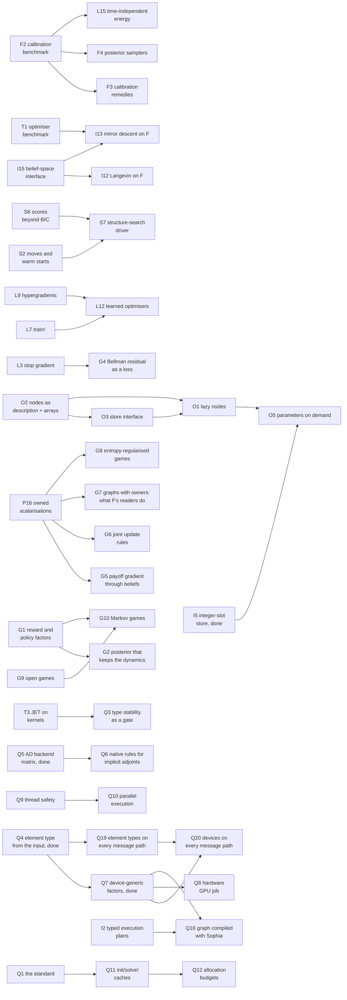

#overview

> The features Lenticulum.jl should get, in one list: what each is for, where it was asked for,
> what measurement motivates it, and how far it is. A feature is added here when a
> specification, a problem, a review or a measurement asks for it, and moved to "done" with the
> commit that implemented it. The rows are in one note per section, listed below; this note holds
> the conventions, the dependency graph and the proposed order. Priorities are proposals until Daniel sets them.

> Sources: original to this repository; the open lists of [[Specifications]] and [[Problem Log]], [[LP-023 Findings of the external reviews of 2026-11-04]].

Status: *planned* (specified or asked for, not started), *proposed* (an idea with a reason, no
specification), *partial*, *done*. Priority: **high** (it limits something measured now),
**medium**, **low**.

**Ids and dependencies.** Every open row has an id: P (the three paths), I (inference), O
(out-of-core), S (structure), L (learning), U (utility factors), G (decisions and games), F (families), T (tooling), Q (quality and engineering). The
column *needs* names the rows that must be done first, because the row builds on them; a row that
only goes better after another says so in its text, not there. Ids are stable: a row that is done
moves to the done note with its id, and a new row takes the next free number of its section. A row with
`—` in *needs* can start now.

## Sections

| id | section | what |
|---|---|---|
| P | [[Backlog P The Three Paths]] | what the refactor review of 2026-11-10 asked for on the three paths; it comes before every other section |
| I | [[Backlog I Inference and Graph Execution]] | compilation, execution plans, schedules, batching, and inference as dynamics on the free energy |
| O | [[Backlog O Out-of-Core Graphs]] | a graph kept in a store and loaded where a query reaches; planned as its own package |
| S | [[Backlog S Structure Search and Editing]] | edits, moves, gates, scores and a search driver |
| L | [[Backlog L Learning]] | M-steps, gradient semantics, `train!`, hyperparameters, and losses for energy factors |
| U | [[Backlog U Utility Factors and Data]] | data loading and the small exact factors written by hand today (asked for 2026-11-05) |
| G | [[Backlog G Decisions, Control and Games]] | control as inference, owned scalarisations in games, open games, beliefs over hypotheses (asked for 2026-11-16) |
| F | [[Backlog F Families]] | implicit diffusion: calibration and posterior samplers; likelihoods, polynomial and algebraic factors |
| T | [[Backlog T Tooling]] | benchmarks for optimiser design and regression tracking |
| Q | [[Backlog Q Quality and Engineering]] | the SciML/JuliaHub standard across the repository: types for dispatch, any AD backend, any array type, parallel execution, benchmarks and profiles as gates, and the factor graph compiled ahead of time with Sophia (asked for 2026-11-24) |

Done rows: [[Backlog Done 2026-11]] (newest first, one note per month).

**Keeping it current.** A new row goes into its section's note with the next free number of that
section. A row that is done is removed from its section's note and written, with its id, at the top
of the current month's done note under the day's heading. If the row is in the dependency graph
below, mark it done there or remove it.

## What depends on what

The open rows that need another open row (every row not drawn here needs nothing open):

F2 is *partial*; its present problems (circle, lemniscate, rings) suffice for F3, F4 and L15.

**Proposed order (2026-11-11, until Daniel sets one):** of that list one thing is open, the energy
threshold of F3 (off-relation detection), which needs an energy network. The rest is done (I5, P1,
P17, P18, P19, I18, P11, I6, I19, I20, I21, and the round trip and ridge residual of F3:
[[Backlog Done 2026-11]]; the later measurements against RxInfer are in [[Benchmark against RxInfer]]).
No order is proposed for the other open rows.
